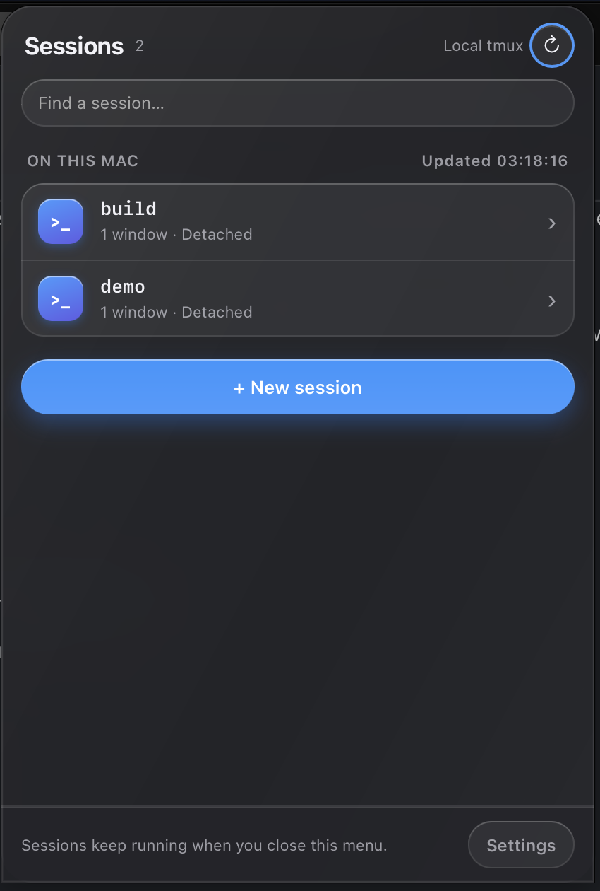
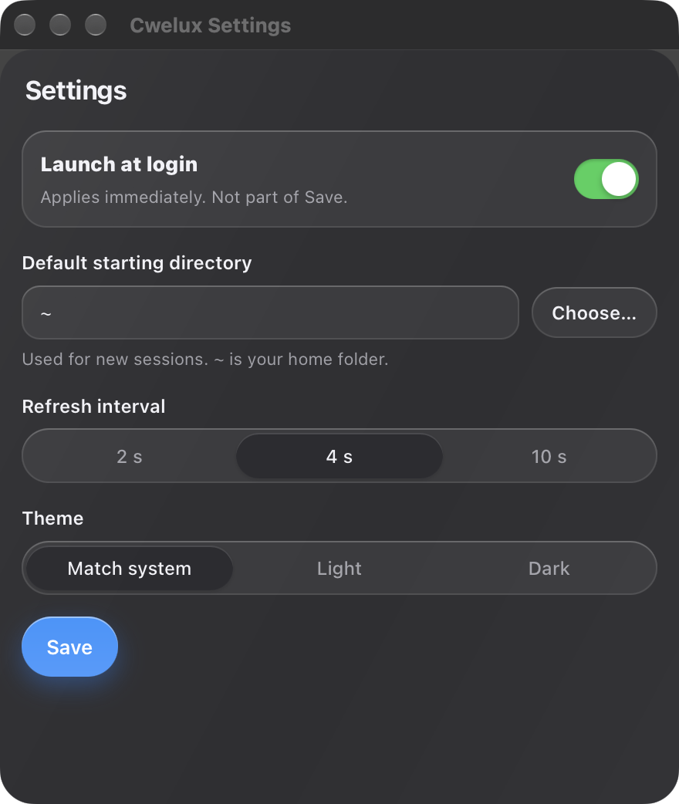

# Cwelux

Manage local tmux sessions from the macOS menu bar. Built with **Tauri 2, Rust, TypeScript and Bun**.

Cwelux handles the routine commands while your terminal stays available for interactive work. Closing the popover does not stop your sessions.

<p align="center">
  
  
</p>

## Features

- **Find sessions:** search by name and see window counts and attached clients.
- **Inspect a session:** browse its windows and panes, current commands and working directories.
- **Preview output:** read the last 200 lines of a pane without attaching to it.
- **Manage sessions:** create a detached session, rename it, or end it after confirmation.
- **Return to the terminal:** open a session in the default terminal handler or copy its attach command.
- **Settings:** a separate window, opened from the tray menu or the popover footer.
- **Native look:** both windows are translucent glass over the desktop. With Reduce transparency enabled in System Settings they fall back to a solid background.

Ending a session stops all processes in its panes. Cwelux asks for confirmation first.

## Settings

Open Settings from the tray icon's right-click menu or the **Settings** button at the bottom of the popover. The window opens in the centre of the screen.

| Setting | Options | Default |
| --- | --- | --- |
| Launch at login | On or off | Off |
| Default starting directory | Any existing folder, with a folder picker | Home folder (`~`) |
| Refresh interval | 2, 4 or 10 seconds | 4 seconds |
| Theme | Match system, light or dark | Match system |

Refresh interval and Theme are segmented controls. Launch at login is a switch.

Preferences are saved to `preferences.json` in the app's config folder and survive restarts. Refresh interval and theme apply to the running app straight away. Launch at login applies as soon as you toggle it and is not part of **Save**.

While Settings is open, the popover does not hide when it loses focus, so you can use both side by side. The tray icon and Escape still close it. For launch at login, move the app to a stable location such as `/Applications` first.

## Remote hosts (stage 1)

Cwelux can also list tmux sessions on other machines. Each host appears below the local list and the **+ New session** button, under a heading such as `ON LOCAL-ARCH`. It shows `Online` with a session count, or `Offline` with the reason, for example `token rejected` or `timed out after 3 s`. The search box filters remote sessions too.

Remote sessions are read-only. You cannot open, rename or end them from Cwelux, and clicking a remote row does nothing.

Each host runs `cwelux-agent`, a small HTTP server that reports its tmux sessions. See [`agent/README.md`](agent/README.md) to build and install it.

List the hosts in `remote-hosts.json`, in the same folder as `preferences.json`. On macOS that is `~/Library/Application Support/dev.cwelux.app/`, or the folder in `CWELUX_CONFIG_DIR` when set.

```json
{
  "hosts": [
    { "name": "local-arch", "url": "http://100.64.0.5:7788", "token": "<token from the agent's token file>" }
  ]
}
```

- `name`: 1 to 64 characters, unique.
- `url`: `http://` with a host and optional port. No path, query or fragment.
- `token`: the same token the agent reads from its token file.

Without the file, no remote hosts are shown. A malformed file shows `Could not read remote hosts.` with the reason. Cwelux reads the file on every refresh, so edits apply without a restart. There is no settings screen for hosts yet.

Only plain `http` is supported. Use it over a private network such as Tailscale, which already encrypts the traffic. The token keeps other machines on that network from reading the list. `https` URLs are accepted in the file but do not work yet.

A reply is checked before it is shown. A host that answers with more than 500 sessions, a session name over 256 characters, or a number too large for the app is shown as offline with the reason, and the other hosts are not affected.

## Requirements

- macOS. Other operating systems are not supported in this version.
- [tmux](https://github.com/tmux/tmux), installed separately. Cwelux does not bundle it.
- [Bun](https://bun.sh) and a current stable [Rust toolchain](https://rustup.rs).
- Xcode Command Line Tools for building the native app.

The initial app was tested with Bun 1.4.2, Rust 1.92.0 and tmux 3.8.

## Build and run

Install tmux if needed:

```sh
brew install tmux
```

Clone and build:

```sh
git clone https://github.com/kolezka/cwelux.git
cd cwelux
bun install --frozen-lockfile
bun run tauri build --bundles app
open src-tauri/target/release/bundle/macos/Cwelux.app
```

The app runs in the menu bar, not the Dock. Left-click its icon to toggle the popover. Right-click for Settings and Quit.

This produces a local app bundle. It is not a signed or notarized distribution release.

## Development

```sh
bun install --frozen-lockfile
bun run tauri dev
```

`bun run dev` starts only the frontend on port 1420. A plain browser cannot access the native tmux bridge and shows a desktop-app-required message instead of sample sessions.

## Default terminal

The open action passes a private `.command` launcher to macOS Launch Services. Cwelux does not hard-code Terminal or iTerm. The application associated with `.command` files must support executing them; if yours does not, use **Copy attach command** instead.

The attach command targets the same tmux server as the app. A successful handoff to macOS does not guarantee that another application has finished attaching.

## Environment overrides

Set these before launching the app:

| Variable | Purpose |
| --- | --- |
| `CWELUX_TMUX_PATH` | Absolute path to the tmux executable. Otherwise Cwelux searches PATH and standard Homebrew locations. |
| `CWELUX_TMUX_SOCKET` | Absolute socket path, passed to tmux as `-S`. Leave unset to use the normal local server. |
| `CWELUX_CONFIG_DIR` | Absolute folder for `preferences.json` and `remote-hosts.json`, useful for testing. It does not affect launch at login. |

For example, to work with an explicitly selected test server:

```sh
CWELUX_TMUX_SOCKET=/absolute/path/to/test.sock bun run tauri dev
```

Invalid overrides produce an error rather than falling back to a different executable or server.

## Tests and checks

```sh
bun test
bun run check
bun run build
cargo fmt --manifest-path src-tauri/Cargo.toml -- --check
cargo test --locked --manifest-path src-tauri/Cargo.toml
cargo clippy --locked --manifest-path src-tauri/Cargo.toml --all-targets -- -D warnings
```

Build the frontend before running Rust checks from a fresh clone so the assets Tauri embeds are present.

Live tmux integration tests currently expect `/opt/homebrew/bin/tmux`. They use private temporary sockets rather than your default tmux server.

## Scope and limitations

- One local tmux server at a time. Remote hosts are read-only lists, reached through `cwelux-agent` over plain HTTP. No SSH or embedded interactive terminal.
- Pane output is read-only and rendered as text.
- No application telemetry or cloud service.
- Other terminal handlers and mixed-DPI multi-monitor placement need further testing.
